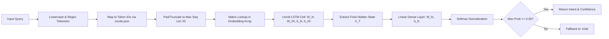
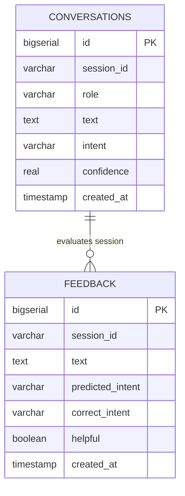

# System Architecture & Technical Specifications: Sam AI Voice Assistant

## 1. System Overview
**Sam** is a voice-first conversational AI web application designed as an end-to-end college capstone project. The architecture cleanly decouples client-side speech processing from serverless text-based natural language processing (NLP), enabling zero-cost deployment, zero server audio bandwidth, and sub-millisecond local intent classification.

---

## 2. High-Level Component Architecture

```mermaid
graph TD
    subgraph Browser ["Client-Side Browser (Chromium / Web Speech API)"]
        UI["Dark Glassmorphic UI & 4-State Orb"]
        WSR["Web Speech API (SpeechRecognition)"]
        WSS["Web Speech API (SpeechSynthesis)"]
        WPD["Wake Phrase Scanner ('Hey Sam' / 'Sam')"]
        ACP["Audio Collision Controller"]
        LS["Client Storage (localStorage)"]
    end

    subgraph Backend ["Serverless Backend (FastAPI / Python 3.11+)"]
        API["FastAPI App (app.py)"]
        RL["Rate Limiter (Sliding Window)"]
        VAL["Pydantic Input Validator"]
        TOK["Deterministic Tokenizer & Encoder"]
        
        subgraph Inference ["Pure-NumPy Inference Engine"]
            NPZ["Weights (intent_weights.npz)"]
            VOCAB["Vocabulary (vocab.json)"]
            LSTM["NumPy LSTM Cell & Softmax Forward Pass"]
        end
        
        subgraph Router ["Skill & Fallback Router"]
            SK_TIME["Time Skill (Action Marker)"]
            SK_SITE["Site Launch Skill (Strict Allowlist)"]
            SK_SEARCH["Search Skill (Google URL Encoder)"]
            SK_CHAT["Chat Router (Confidence < 0.5 Fallback)"]
        end
    end

    subgraph External ["External Services"]
        GROQ["Groq Cloud API (LLaMA 3.3 70B Versatile)"]
        DB["Optional PostgreSQL (Neon / Supabase)"]
    end

    %% Client data flow
    UI -->|User Gesture| WSR
    WSR -->|Live Speech Transcript| WPD
    WPD -->|Clean Utterance| API
    UI -->|Typed Input| API
    API --> RL --> VAL --> TOK --> LSTM
    NPZ -.-> LSTM
    VOCAB -.-> TOK

    %% Routing
    LSTM -->|Intent: time| SK_TIME
    LSTM -->|Intent: open_site| SK_SITE
    LSTM -->|Intent: search| SK_SEARCH
    LSTM -->|Intent: chat OR Conf < 0.5| SK_CHAT

    SK_CHAT -->|Bounded History| GROQ
    API -.->|Async Best-Effort| DB

    %% Responses back to client
    SK_TIME -->|{action: 'time'}| UI
    SK_SITE -->|{url: 'https://...'}| UI
    SK_SEARCH -->|{url: 'google.com/search'}| UI
    SK_CHAT -->|Spoken Plain Text| UI
    
    UI --> ACP
    ACP -->|1. Pause Listening| WSR
    ACP -->|2. Synthesize Voice| WSS
    WSS -->|3. On Complete: Resume| WSR
    UI -.-> LS
```

---

## 3. Audio Collision Prevention Sequence Diagram

One of the most critical engineering challenges in browser voice assistants is **acoustic echo loops** (where the assistant transcribes its own voice synthesized from the device speakers). Sam implements an event-driven collision prevention controller:

```mermaid
sequenceDiagram
    autonumber
    actor User
    participant Browser as Browser UI (Orb)
    participant WSR as SpeechRecognition
    participant API as FastAPI /chat
    participant WSS as SpeechSynthesis

    User->>Browser: Speaks "Hey Sam, what time is it?"
    WSR->>Browser: onresult(transcript)
    Browser->>Browser: Set Orb State: THINKING (Purple)
    Browser->>API: POST /chat {"text": "what time is it?"}
    API-->>Browser: Response: {"intent": "time", "reply": "It's currently {time}.", "action": "time"}
    
    rect rgb(30, 41, 59)
        Note over Browser,WSS: Audio Collision Prevention Barrier
        Browser->>Browser: Replace {time} with Local System Clock (e.g. 7:30 PM)
        Browser->>WSR: abort() / stop() [HALT LISTENING]
        Browser->>Browser: Set Orb State: SPEAKING (Amber)
        Browser->>WSS: speak("It's currently 7:30 PM.")
        WSS-->>Browser: utterance.onend event fired
        Browser->>Browser: Set Orb State: IDLE or LISTENING (Green)
        Browser->>WSR: start() [RESUME LISTENING]
    end
```



---

## 4. Pure-NumPy Inference Pipeline

PyTorch is utilized strictly offline during development for model benchmarking and gradient backpropagation. The trained model weights are exported as standard NumPy matrices, allowing the production server to run with zero PyTorch installation.



---

## 5. Database Entity-Relationship Diagram (Optional)

When `DATABASE_URL` is configured, PostgreSQL tables operate with schema isolation and non-blocking asynchronous persistence:



---

## 6. Security & Sandboxing Constraints
1. **Zero Client Audio Transmission:** Audio data remains strictly within browser memory via W3C Web Speech API.
2. **Strict Site Allowlist:** The `open_site` skill exclusively navigates to predefined URLs (`youtube.com`, `google.com`, `github.com`, etc.). Unrecognized domains are converted into Google search links.
3. **Sliding-Window Rate Limiting:** Enforces 60 requests per minute per IP to protect against denial-of-service and API quota exhaustion.
4. **Credential Isolation:** The `GROQ_API_KEY` is stored strictly on the server and never exposed in HTML, client JavaScript, or API responses.
